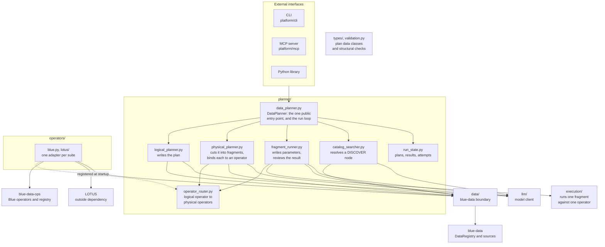

# blue-data-planner — High Level Architecture

## Diagram

Requests enter through one class, `DataPlanner`. The three planning stages, the operator lookup, and
execution are separate components that share only the data classes at the package root.

Arrows are dependencies, read as "uses", except the one dashed arrow, which is what happens once at
startup rather than while a request runs. `types/` and `validation.py` are drawn without arrows
because anything may import them.

The diagram is structure, not sequence. What order the stages run in, and where a failure sends the
run back to, are in [04-detailed-architecture.md](04-detailed-architecture.md).

---

## Components

### External interfaces

The CLI and the MCP server are adapters in front of the library. Each translates requests and
responses and holds no planning or execution logic (ADR-002).

| Interface | Package | Use |
| --- | --- | --- |
| Python library | `lib/` | Embedding planning in a Python application |
| CLI | `platform/cli/` | Asking a question and reading the answer directly |
| MCP server | `platform/mcp/` | Giving an agent framework a planning tool |

### DataPlanner

The one public entry point, with two operations. Both take a request in plain language, and neither
takes a plan: a plan is what a request produced, not something a caller hands in.

| Operation | Returns | Spends operator calls |
| --- | --- | --- |
| Run a request | The rows that answer it, together with every plan and every attempt the run produced | Yes |
| Plan a request | The same record with status `planned` and no rows: the logical plan and the cover over it, and nothing run | No |

The second is what the CLI's `--explain` prints, and what a measurement of where pushdown boundaries
get drawn reads. Argument and return shapes are in
[09-api-interface-spec.md](09-api-interface-spec.md).

`DataPlanner` owns the loop from request to answer, set out in
[04-detailed-architecture.md](04-detailed-architecture.md). The loop does seven things, and none of
them calls a model or invokes an operator directly.

| The loop | Detail |
| --- | --- |
| Schedules | Takes the next fragment whose frontier all has results, or a control node that is ready |
| Dispatches on kind | A fragment goes to the fragment runner, a `DISCOVER` node to the catalog searcher, a `REPLAN` node ends the pass |
| Counts attempts | Per node set, per cover, and per request, which is what tells one repair from the next |
| Chooses the repair | Only the loop knows how many attempts each repair has left, so only the loop can pick one |
| Installs a cover | Compares a new cover with the previous one and drops the results the change invalidated |
| Bills the budget | Operator calls against the operator call budget |
| Assembles the result | One `PlanResult` whether the request succeeded or not |

Keeping the loop here rather than in `execution/` is what lets `execution/` run without importing
`planner/` (ADR-011). `DataPlanner` is given the components below rather than building them, so it
looks up no operator and calls no model itself. `build_data_planner` does the wiring every
adapter needs, which keeps assembly out of the adapters.

### `planner/`

| Module | Owns |
| --- | --- |
| `logical_planner.py` | `LogicalPlanner`. Reads the request and a preview of the catalog, and writes a plan in the fixed vocabulary of logical operators. Every node it writes carries one instruction in plain language, and no source, no operator, and no operator parameters. |
| `physical_planner.py` | `PhysicalPlanner`. Cuts the plan into fragments and binds each one to a physical operator, and each `SCAN` to a source. It enumerates the fragments each operator's declaration allows and has a model pick among them, since the size of a fragment is the pushdown decision itself. |
| `fragment_runner.py` | `FragmentRunner`. Runs one ready fragment: writes the operator's parameters against the columns and values its inputs actually carry, has it executed, checks the declared columns, and reviews the result. Returns accept, escalate, replan, or stop. |
| `catalog_searcher.py` | `CatalogSearcher`. Resolves a `DISCOVER` node by turning its instruction into search terms and searching the registry. Not a fourth stage: its output is catalog records read by the logical planner, not rows entering the data flow. |
| `operator_router.py` | `OperatorRouter`. Maps a logical operator to the physical operators that can carry it out, and resolves an operator id to the operator behind it. Lookup and nothing more: whether a particular node has an operator depends on the fragment it sits in and the source its scans are bound to, so it is asked per node by the physical planner and answered as `no_operator`. Only the router is read while planning, never the registry (ADR-009). |
| `run_state.py` | `RunState`, the one mutable object per request. Holds every plan version, the results keyed by logical plan and then node, every fragment attempt including the rejected ones, the model usage, and the counters the loop reads to choose a repair. `DataPlanner` creates it and alone writes to it. |
| `data_planner.py` | `DataPlanner` and `build_data_planner`. The entry point lives beside the stages it drives, since everything in this package turns a request into an answer and nothing outside it reads `RunState`. |

Four terms carry the design, and each is fixed in
[04-detailed-architecture.md](04-detailed-architecture.md) and
[10-data-model.md](10-data-model.md).

| Term | Means |
| --- | --- |
| Logical operator | What a step is for, in a vocabulary that belongs to no operator suite: `SCAN`, `FILTER`, `PROJECT`, `EXPAND`, `AGGREGATE`, `DISTINCT`, `SORT_SUPERLATIVE`, `JOIN`, `UNION`, `RETURN` |
| Physical operator | One implementation declaring which logical operators it can carry out, which kinds of source it can read, whether it accepts tables bound in from elsewhere, and what it cannot do |
| Fragment | A group of neighboring nodes one physical operator runs in a single call. Connected, convex, disjoint from every other fragment, and single exit |
| Cover | One physical plan's fragments over one logical plan. Written whole, never patched, and kept beside the covers it replaced |

A plan holds three kinds of node. An operator node is absorbed into a fragment. `RETURN` is bound to
no operator, because projecting named columns admits no implementation choice. `REPLAN` and
`DISCOVER` are control nodes, absorbed into nothing, and both end the pass.

Searching the registry is not an operator. It answers a question the planner asks on its own behalf,
and what comes back is catalog records rather than rows, so it never fitted the operator contract.

### `execution/`

The single place any operator is invoked. It runs one physical operator over the tables it was
handed, bills the call against the operator call budget, and checks the result against the output
columns its caller declared, coercing each to its declared type.

Three things it does not do, and each one removes an import. It does not schedule, because the run
loop decides what is ready and hands down one call at a time. It does not resolve an operator id,
because its caller hands it a resolved operator. It does not call a model, because writing
parameters and reviewing a result both belong to the fragment runner. Together those keep
`planner/`, `operators/`, and `llm/` out of its imports (ADR-011).

### `types/` and `validation.py`

Both sit at the package root: `types/` imports nothing outside itself, and `validation.py` imports
only `types/`. Keeping them there lets `execution/`, `planner/`, and `operators/` share a
vocabulary without importing each other.

`types/` holds every data class that crosses a module boundary: `DataPipeline` and the plan
versions it contains, `PipelineNode`, the physical plan and its fragments, every result type, the
three catalog readings `data/` produces, and the `LLMUsage` records `llm/` produces. A type
`PlanResult` names has to be nameable by everything that reads a `PlanResult`, so the line lands
here: `types/` holds data, and every other module holds behavior.

Inside it, `errors.py`, `plan.py`, `catalog.py`, and `run.py` split those classes by subject, and
`__init__.py` re-exports all four. Every importer reads the one name `blue_data_planner.types`.

`validation.py` holds two structural checks, both run before anything is executed. One rejects a
logical plan the run loop could not schedule; the other rejects a cover that could not be run. What
each turns down is in [06-library.md](06-library.md#validation).

### `operators/`

No operator is written here. The Blue operators and the registry that resolves them belong to
`blue-data-ops`, and LOTUS is its own package. This module holds one adapter per suite.

| Path | Holds |
| --- | --- |
| `blue.py` | Declares the operators of a `blue-data-ops` registry as physical operators. |
| `lotus/` | Declares LOTUS operations as physical operators. |

An adapter returns a list of physical operators rather than registering them, so `operators/` never
imports `planner/`. Whoever assembles the planner registers what comes back, which is the dashed
arrow in the diagram and happens once at startup.

What an operator declares decides which groups of nodes it competes for, not just which nodes. An
operator declaring one logical operator can only ever cover a single node. Declaring several is what
makes pushdown possible.

A fragment passes a list of tables, each a plain list of row dicts. The Blue operators take and
return this same shape, so the Blue adapter converts nothing and the LOTUS adapter converts at its
own edge (ADR-012).

### `data/`

The only place in the shipped package where `blue-data` is imported. `DataCatalog` selects and
renders what `blue-data` has already collected and enriched, and profiles nothing of its own. Five
callers go through this boundary.

| Caller | Reads |
| --- | --- |
| `LogicalPlanner` | A preview of the catalog: which sources exist, and what each is for |
| `CatalogSearcher` | A registry search, one call per search term |
| `PhysicalPlanner` | The catalog paths a `SCAN` may be bound to, and the kind of source behind each |
| `FragmentRunner` | A view of each column its fragment touches: sample values as they are spelled, and what `blue-data` inferred about them |
| An operator bound to a fragment | Its own source, for reading and for the few calls that write |

Concrete implementations are supplied at startup rather than constructed in place.

The boundary reads a registry and never builds one. Registering sources, syncing them, collecting
their statistics, and enriching them are ingestion, which belongs to `blue-data`, so a registry
reaches this package already populated and a caller with no registry builds one there first. The one
place that does build a registry is the TAG-Bench script, which is a build step rather than shipped
code and calls `blue-data` directly ([07-repo-organization.md](07-repo-organization.md)).

### `llm/`

The model client shared by all four components that call one: the logical planner, the physical
planner, the fragment runner, and the catalog searcher. It holds prompt templating and its own error
types. Nothing else in the library calls a model.

---

## Dependency rules

Each rule is checkable by reading imports.

1. `types/` imports nothing outside itself, and `validation.py` imports only `types/`.
    Anything may import either.
2. `execution/` does not import `planner/`, `operators/`, or `llm/`. It runs one fragment against
    one operator it is handed.
3. Nothing outside `data/` imports `blue-data`, and nothing outside `operators/lotus/`
    imports LOTUS. The LOTUS import sits inside a callable, never at module import time.
4. `operators/` does not import `planner/`. An adapter returns physical operators; it registers
    none.
5. `platform/*` imports only the public surface. No adapter reaches into a module below it.

---

## What is deliberately absent

| Not here | Why |
| --- | --- |
| Agents | Out of scope for this repository. Agent frameworks call in through the MCP server. |
| REST API | Not part of the first release. The CLI covers direct use and the demo, and MCP covers the agent frameworks that are the stated integration target, so a REST API would add deployment and operations work no consumer has asked for. `platform/api/` is reserved for one. |
| A plan store, and any path that runs a plan handed in from outside | A plan is what a request produced. `DataPlanner` takes a request and nothing else. |
| Benchmark harness | TAG-Bench is a target for measuring this architecture, not a component of it. Its inputs live under `data/` ([11-testing-strategy.md](11-testing-strategy.md)). |
| Cost and cardinality estimates | Choosing an operator or a fragment size by estimated cost is out of scope for the first release. |
| Plan optimization | Beyond the structural checks, a plan is not rewritten to a cheaper equivalent. |
