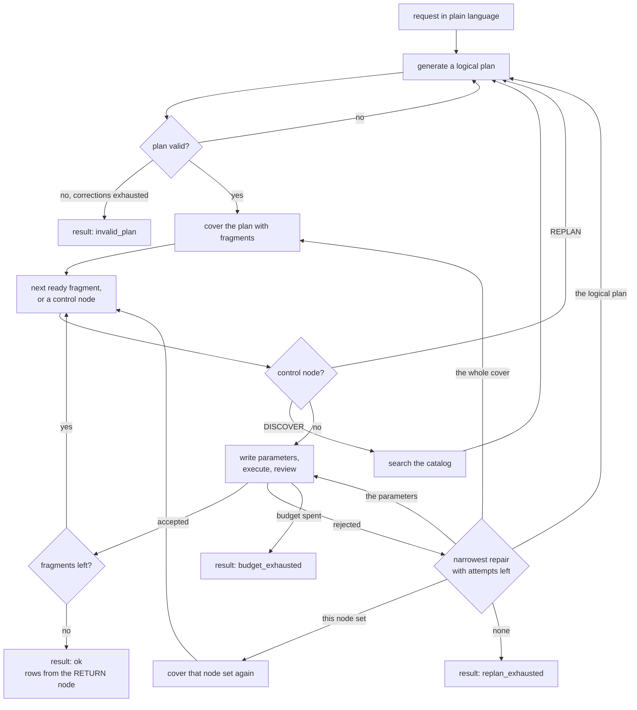

# blue-data-planner — Detailed Architecture

This document follows one request through the components named in
[03-high-level-architecture.md](03-high-level-architecture.md). It says what each stage reads, what
it produces, and what happens when a stage fails.

## Request lifecycle

The diagram shows the endings the flow itself produces. `operator_failed` and `llm_failed` can end a
request from any stage, so both appear in the table under
[what the caller receives](#what-the-caller-receives) and not here. `planned` is the ending of the
planning-only operation, which stops after the first cover
([03-high-level-architecture.md](03-high-level-architecture.md#dataplanner)).

A request is the only input. A plan is what a request produced, never something handed in, so there
is no entry point that takes one and runs it. Asking the same question twice plans it twice. What a
caller keeps is the record of a run, not an input to the next one.

---

## The three stages

Each stage asks a model a different question. The answers are recorded separately, so a wrong one
can be found and repaired on its own ([section 5](#5-recovering-from-a-failure)).

| Stage | Question | Component | Reads | Runs |
| --- | --- | --- | --- | --- |
| Logical planning | What is the user asking for | `LogicalPlanner` | The request and a preview of the catalog | Once per pass |
| Physical planning | How much of the plan does each operator take on, and against which source | `PhysicalPlanner` | The plan, what each operator declares, and what the catalog holds | Once per pass, over the whole plan |
| Fragment execution | What parameters does it run with, and was the result any good | `FragmentRunner` | The rows its inputs produced | Once per fragment, during execution |

A stage is a step of planning; the component beside it is the class that carries the step out, and
the three together are the planning components.

The first two stages run before anything executes. The third runs during execution, so it is the
only stage that sees data.

### Fragments and pushdown

Physical planning cuts the plan into fragments. A fragment is a group of neighboring logical nodes
that one operator runs in a single call, and the operator is said to absorb the nodes in it.

Most operators absorb one node. A semantic filter takes a `FILTER` node and nothing else. Others
absorb many. A Text-to-SQL operator writes and runs one SQL query that scans, filters, joins, and
aggregates, so it can take a whole region of the plan at once. Handing it that region is a pushdown,
in the sense the term has in federated query processing.

How much to push down is the decision physical planning exists to make. A larger fragment means
fewer calls and less data moved between them, and the operator either does the whole thing correctly
or fails as a unit. A smaller fragment can be checked and repaired step by step, at the cost of
running each step separately.

Physical here is relative to this planner, not absolute. It means a unit this planner does not look
inside. A Text-to-SQL operator runs a full query engine behind its natural-language interface, and
that engine writes its own logical and physical plans, none of which appear here. Federated query
processing works the same way. A subplan pushed to a remote source shows up in the mediator's plan
as one operator, and the source plans it again from scratch.

### Three kinds of node

A plan is a DAG of typed nodes. The kind decides what happens when the node comes up.

| Kind | Nodes | Bound to an operator | What happens |
| --- | --- | --- | --- |
| Operator | `SCAN`, `FILTER`, `PROJECT`, `EXPAND`, `AGGREGATE`, `DISTINCT`, `SORT_SUPERLATIVE`, `JOIN`, `UNION` | Yes | Absorbed into a fragment and run by the operator that fragment was bound to |
| Terminal | `RETURN` | No | Projects the named columns and ends the run |
| Control | `REPLAN`, `DISCOVER` | No | Ends the pass and returns to the logical planner |

[10-data-model.md](10-data-model.md#node-kinds-and-what-their-attributes-hold) fixes what each
node's `attributes` carry and how many inputs each takes.

An operator node carries one instruction in plain language and nothing else (ADR-008). It names no
source and no operator, because both can differ between passes over the same node. Both are recorded
in the physical plan instead.

A node may list more inputs than its kind transforms. The extra ones are reference inputs: the
instruction mentions their rows without transforming them. That is how a filter compares against a
value another node produced
([10-data-model.md](10-data-model.md#how-many-inputs-a-node-takes)).

`RETURN` is bound to no operator because selecting named columns admits no implementation choice.
Keeping it off the router means nothing has to register an operator for it.

Both control nodes act as barriers. A node is only ready once every input it lists has a result, so
one placed over three parallel paths needs no scheduling code of its own. When one comes up, the
pass ends and the logical planner writes a continuation
([section 4](#4-returning-to-the-logical-planner)).

| Control node | Waits for | Gives the planner |
| --- | --- | --- |
| `REPLAN` | The results of the nodes it lists | Those results, so the rest of the plan can be written against real columns and values |
| `DISCOVER` | The same, and it may list none | Catalog records found by searching the registry, so a later `SCAN` can name a source |

Only `DISCOVER` does work of its own, and none of it is an operator call
([section 4](#resolving-a-discovery-node)).

---

## 1. Logical planning

The logical planner reads the request text and a preview of the data catalog obtained through
`data/`. The preview holds source-level records only: a name, the kind of source, and the
plain-language description `blue-data` enrichment wrote for it, where one exists. The list is ranked
against the request text and capped, and it reports the total number of registered sources, so the
planner can tell a complete list from a sample.

That is deliberately less than the registry holds. Tables, columns, and types are one search away,
and putting them all in every prompt would make the prompt grow with the registry instead of with
the request. The preview has one decision to support: whether the sources this request needs are
already visible.

The planner produces a `LogicalPlan` as structured output. The model fills a response schema built
from the node schemas, so a plan naming an invented operation never reaches validation: a provider
supporting strict structured output cannot produce one, and where a provider does not, the response
is refused when it is read
([05-software-stack.md](05-software-stack.md#structured-output)).

### Writing a plan that can be pushed down

A Text-to-SQL operator can only absorb a scan, its filters, and its joins if those nodes exist when
physical planning runs. A plan that stops at its scans and defers the rest has nothing to absorb,
and the pushdown decision never comes up.

The prompt therefore asks for a complete plan, from `SCAN` through `RETURN`, whenever the planner
has enough to write one. A control node is for the case where it genuinely does not: the request
needs data the preview does not show, or the shape of the remaining work depends on columns nobody
has seen yet.

Nothing in validation enforces this. A plan that ends at a control node on its first pass is valid,
and so is one with no control node at all, which is what a request answerable from the model's own
world knowledge looks like.

### Validation

`validate_logical_plan` then checks the plan. A rejected plan goes back to the same conversation
with the validation error appended, up to a fixed number of corrections. The rejected plan and its
error both stay in the session, so a run that ends in `invalid_plan` shows what was attempted.

Validation accepts two plan shapes: exactly one `RETURN` node, or a terminal control node and no
`RETURN` at all. The `RETURN` arrives in a continuation. A plan carrying a control node and a
`RETURN` after it is rejected, since the planner cannot both defer the ending and write it.

---

## 2. Physical planning

The physical planner covers the plan's operator nodes with fragments and binds each fragment to one
operator.

### What a fragment may be

| Rule | Why |
| --- | --- |
| Connected | The nodes have to describe one computation |
| Convex: no node outside the fragment lies on a path between two nodes inside it | Execution cannot leave an operator and come back |
| Disjoint from every other fragment | Each node is run exactly once, by one operator |
| Single exit: only the root may have consumers outside the fragment | A fragment returns its root's output and nothing else, so an absorbed node's table is never materialized. A node read from outside the fragment would leave that reader waiting for a table nobody produces |
| Contains only operator nodes | `RETURN`, `REPLAN`, and `DISCOVER` are never absorbed |

### What an operator declares

An operator declares the set of logical operators it can execute, the kinds of source it can read,
and whether it accepts tables bound in from elsewhere
([10-data-model.md](10-data-model.md#a-physical-operator)). Nothing else. Candidate fragments follow
mechanically: grow a connected, convex subgraph using only nodes whose kind is in that set. A
fragment containing a `SCAN` also needs a source, and the operator's declared source kinds decide
which sources it may be given.

An operator declaring a single logical operator can only ever match a single node, which is what
every atomic operator declares.

| Operator | Declares | Matches |
| --- | --- | --- |
| A semantic filter | `{FILTER}` | One `FILTER` node |
| A join | `{JOIN}` | One `JOIN` node |
| A Text-to-SQL operator | `{SCAN, FILTER, PROJECT, JOIN, AGGREGATE, DISTINCT, SORT_SUPERLATIVE}`, SQL sources, accepts bound inputs | Any convex subgraph of those kinds whose scans are SQL |

A node several other nodes read is a fragment of its own, because absorbing it would break the
single-exit rule. Pushing it into both branches would mean scanning twice, which no cover does.

A declaration says nothing about the order the kinds appear in. A Text-to-SQL operator cannot state
that it absorbs a `FILTER` only when the filter sits directly above its own scan, because the
declaration has no vocabulary for position. For SQL that costs nothing, since any convex subgraph of
those kinds is expressible as one query. How to handle an operator whose real capability depends on
shape is an open question.

### Choosing among candidates

The physical planner works top down from the root of the plan, in the style of a Cascades optimizer.
For each uncovered node it enumerates the candidate fragments rooted there, one per matching
operator per subgraph, and a model picks one. If no candidate covers the node, it descends to
smaller fragments. If nothing matches the node alone, the node has no operator.

A model picks instead of the code taking the largest match, because the size of a fragment is the
pushdown decision itself. A rule that always absorbs the maximum would settle in advance the
question the planner is there to answer. Greedy maximal matching stays available as a model-free
baseline.

Along with the fragment and its operator, the model writes three things.

| Written during physical planning | Why then |
| --- | --- |
| A catalog path for each `SCAN` in the fragment | Which source a scan reads decides which operators can run it, so the source and the operator are one choice rather than two |
| One instruction covering the whole fragment, phrased as an instruction to the operator | A fragment absorbing four nodes has no single instruction to borrow. The model writes what the fragment is to do instead of stringing together what it absorbed |
| A name and a description for each input the fragment receives | An operator handed a bundle cannot tell a scan target from an auxiliary table, and column names are not known yet |

The response schema for one of these calls is built from that call's candidates, the same way an
operator's `parameter_schema` is built from that operator. A candidate set with no `SCAN` in it has
no place in the schema to name a source, and where a scan does appear the paths the catalog offers
become the allowed values. An impossible choice never appears as an option, so nothing has to reject
it afterwards.

Everything else waits for execution. Column names, types, and rows are not known until the upstream
fragments have run, and the parameters that depend on them are written then
([section 3](#3-running-a-fragment)).

A fragment inherits `required_output_columns` from its root node unchanged. The model rewrites that
list only when it declares that the fusion cannot produce those columns. The default therefore stays
deterministic, and the model's discretion is confined to an exception path.

### A cover is written whole

A cover is written for the plan as it stands and is never patched into an older one. Each one is a
new object, kept alongside the covers it replaced, and a fragment in it may absorb nodes that
already ran. A result the run is holding is therefore a cache: it can be dropped and produced again.

Installing a cover compares it with the previous one, fragment by fragment.

| A fragment whose node set | What happens |
| --- | --- |
| Is unchanged | Keeps its root's result and does not run again |
| Changed, or is new | Drops the results of every node in it, and of every executed node downstream of those, then runs |

[Section 5](#5-recovering-from-a-failure) is where that matters.

---

## 3. Running a fragment

A fragment is ready when the run holds a result for every node on its frontier. The frontier is the
set of nodes outside the fragment that feed nodes inside it, and it is also the fragment's input:
those nodes' outputs, concatenated in the order the fragment lists them. A fragment with an empty
frontier receives an empty bundle, which is what a scan rooted at a source gets.

`FragmentRunner` runs one ready fragment.

1. Write the operator's parameters, constrained by its `parameter_schema`, as structured output.
2. Call `execute_physical_operator` with the operator, the parameters, the inputs, and the columns
    the fragment's root declares. This is the only place an operator is invoked, and the declared
    columns are checked as part of the call.
3. Review the result.

The parameters are written here rather than during physical planning because this is the first point
where the data exists. The runner sees the input tables' columns, their row counts, and a sample of
rows. For the columns the fragment touches it also sees catalog values: sample values as they are
actually spelled, and whether `blue-data` inferred that a column holds short codes instead of
readable words. A transaction-type column storing `PRIJEM` where a reader would expect `credit` is
one. That is what lets the runner write `values: ["San Francisco", "Palo Alto"]` instead of
guessing at how a column spells its contents.

### What an operator does with its input

The rule is the same for every operator: whatever arrives in the input bundle is data its own engine
does not already have, and making it addressable is the operator's job.

| Physical operator | Empty input | Non-empty input |
| --- | --- | --- |
| A single-node operator | Cannot happen. A one-node fragment always has a frontier | Transform the tables it was handed |
| A source-reading operator that does not accept bound inputs | Read the scan target from the parameters and run against the source | Cannot happen. The physical planner never offers it such a fragment |
| A source-reading operator that accepts bound inputs, such as a Text-to-SQL operator | The same | Make each table addressable, then emit SQL referring to it by name. The scan target still comes from the parameters; the input tables are auxiliary |

How a bound table reaches the source is the operator's decision, not the planner's. Carrying values
inside the query text and loading them into a temporary table suit different volumes of rows, and
the operator is what sees how many rows travel. A planner choosing between them would be a second
planner inside the fragment runner.

Pushing values from one source into another is a bind join, or semi-join reduction, in federated
query processing. The mechanism is borrowed from there.

### Executing

`execute_physical_operator` does four things in order.

1. Refuses parameters the operator's schema does not accept. That is a bug rather than a spent
    call, so it is caught before the budget is touched.
2. Bills one operator call against the budget. An exhausted budget ends the request here.
3. Invokes the operator's callable on the bundle it was handed. A Blue operator takes that bundle as
    it stands; a LOTUS operator converts at its own edge (ADR-012).
4. Checks every table in the result against the declared columns it was handed, matching the
    declared names and coercing each column to the type declared beside it. The type vocabulary and
    the coercion rules are in [10-data-model.md](10-data-model.md#declared-output-columns).

Only the fragment's root node has its declaration checked. The declarations on the nodes the
fragment absorbed are not checked against anything, because a fused call produces no intermediate
tables to check them against. They are still read twice: the physical planner uses them to write the
fused instruction, and one of them is checked again if the fragment is later split.

Neither a zero-row table nor an empty bundle is a failure. Both go on to review like any other
result.

### Reviewing the result

A result that clears the column check goes to a review turn in the runner's conversation with the
model, which keeps the earlier turns. The review sees the fused instruction, the description of the
operator that ran, the instructions of every node the fragment absorbed, and a sample of the result.

The absorbed nodes' instructions are what make a fused call checkable. A single call asked to scan,
filter, and join returns one table and no evidence of the steps inside it, so the review asks
whether each absorbed step is reflected in the result. A Text-to-SQL call handed a semantic
predicate it cannot express in SQL tends to return rows that ignore the predicate, and the node that
carried that predicate is the reason there is anything to notice.

| Decision | Means |
| --- | --- |
| `accept` | The result is recorded under the fragment's root node id, and the loop moves on |
| `reject` | Something about this attempt was wrong, and recovery starts with the narrowest repair |
| `replan` | No arrangement of operators will do this, and recovery goes straight to the replan |

Every attempt reads the fragment's original input, read once before the first attempt. A reduction
one attempt achieved does not carry into the next.

---

## 4. Returning to the logical planner

A control node ends the pass, and so does recovery that has run out of repairs
([section 5](#5-recovering-from-a-failure)). All three paths reach the logical planner the same way.

| Trigger | What the planner reads |
| --- | --- |
| A `REPLAN` node became ready | The node's instruction, and the results its inputs produced |
| A `DISCOVER` node became ready | The node's instruction, and the catalog records the search found |
| Recovery reached the replan | The review's assessment of what could not be done |

A failure reason stays at the level the planner works in. It says what could not be done, not which
operator failed to do it, because naming an operator would invite the planner to work around an
implementation it does not choose.

### Resolving a discovery node

A `DISCOVER` node is resolved rather than run as a fragment. There is no operator to choose and no
parameter schema to fill. `CatalogSearcher` does the whole job, and its output goes to the planner
instead of to a downstream node.

It reads the node's instruction and, when the node has inputs, the tables those inputs produced. A
model turns the two into concrete search terms. An instruction reading "find press release documents
for each company in the input" over a table of company names becomes one search term per company.
The number of terms one node may expand into is capped.

Each term goes to `blue-data`'s registry search through `data/`, which ranks catalog records by
keyword match, value match, and vector similarity together. Vector similarity needs a vector source
and an embedding function; without them the search still runs on the other two signals.

What comes back is a list of catalog records, each with its path, its level, its description, and
the term that found it. The run keeps them under the node's id, and the planner reads them when it
writes the continuation. Nothing is converted into rows, and no operator call is spent.

Because those records carry full catalog paths, the continuation is the first plan whose scans can
be bound to a source. That is what a discovery node buys, and why a request over unknown sources
reaches pushdown one pass later than a request over familiar ones.

### Writing a continuation

Returning to the planner does not discard the run. `DataPlanner` calls the logical planner again
with the request, the catalog preview, the nodes that already succeeded, any catalog records
discovery found, and the reason the pass ended.

What comes back is a continuation: new nodes covering the remaining work, whose input ids may point
at nodes that already ran.

The two are assembled into a new version of the logical plan instead of being edited into the old
one. The new version carries over every node the run has something for and drops the rest, so work
that was planned but never reached is written again by the continuation. It names its parent, and
the results the run holds move across with the nodes they belong to. Validation runs on the new
version, exempting the carried nodes from the checks that would otherwise object to them, and
physical planning then covers it as a whole.

For an operator node, having something means belonging to a fragment whose result the run still
holds, which includes the nodes that fragment absorbed. Those produced no table of their own, but
they describe work the fused call already did. Carrying them keeps the graph whole, since the
fragment's root reads them, and it is what lets a later cover fuse the same nodes again.

### What reading an absorbed node costs

A carried node is not free to read. Reading one that a fragment absorbed throws that whole fragment
away and runs it again.

Suppose `n2`, `n3`, and `n4` were covered by one Text-to-SQL fragment rooted at `n4`, and the
continuation writes `n9` reading `n3`. The rows `n3` describes were never materialized: they
existed inside one SQL query and went out with it, and the only table the fragment produced is
`n4`'s. So anything reading `n3` needs `n3` to be the root of a fragment, which the old cut does not
allow. Putting `n3` and `n9` in one new fragment breaks disjointness, and leaving `n3` where it is
breaks single exit, since `n9` would read a node that is not its fragment's root. Either way the old
cut no longer holds. The plan is cut again, all three nodes lose their standing, and all three run
again. The general rule behind both cases is that a node read from outside its fragment has to be
that fragment's root.

The ordinary replan path never pays this, and the reason is structural. A control node is absorbed
into no fragment, so every node it lists as an input has a consumer outside every fragment and is
therefore a root. The results the planner is handed when a `REPLAN` or `DISCOVER` node fires are
exactly those roots. The cost appears when a continuation reaches past them into the middle of work
that already ran, which a replan after a failure is free to do. Whether to spend a fused call again
for a node the planner wants to read, or to write the continuation from the fragment's root instead,
is left to the planner rather than forbidden. [Section 5](#5-recovering-from-a-failure) is where the
same trade appears from the other side.

The control nodes follow from the same rule. A resolved `DISCOVER` node carries over, because the
run holds what its search found, and never searches twice. A `REPLAN` node that fired holds nothing
and belongs to no fragment, so it is dropped and cannot fire again.

---

## 5. Recovering from a failure

An operator call can fail, and a result that runs can still be wrong. Recovery has four repairs,
ordered by how much work each one throws away. A repair is only tried once the one before it has
run out of attempts.

| Repair | What it rewrites | By | Bounded by |
| --- | --- | --- | --- |
| Parameter | The parameters, against the same fragment and operator | `FragmentRunner` | `parameter_attempts`, per fragment |
| Fragment | The operator, or the way this node set is cut into fragments | `PhysicalPlanner` | `fragment_attempts`, per node set |
| Cover | The whole cover, against the same logical plan | `PhysicalPlanner` | `cover_attempts`, per request |
| Replan | The logical plan | `LogicalPlanner` | `failure_replans`, per request |

Each repair discards strictly more work than the one before it, and costs strictly more to redo.
Starting with the narrowest keeps a wrong parameter from being answered with a new plan.

The order is also readable after the fact. Two consecutive attempts at the same fragment with the
same operator and different parameters are a parameter repair; a different operator over the same
node set is a fragment repair; a fragment whose node set grew is a cover repair. What actually fixed
a run can be counted without instrumenting anything further.

### The parameter repair

The runner writes parameters again for the same fragment and operator, with the failed call's error
or the review's assessment in the conversation it already holds. A model writing an operator's
parameters has to name columns and spell values the way the data spells them, and getting that wrong
is both frequent and cheap to fix, since neither the operator choice nor the fragment boundary was
wrong.

### The fragment repair

The physical planner covers the failed fragment's node set again, with the failure reason in
context. It may bind a different operator to the same set, or cut the set into smaller fragments,
which is the fix for a fragment that absorbed more than its operator could carry out.

Attempts are counted against the node set. Covering it again either keeps the set, which spends
another attempt against it, or produces smaller sets, each of which starts its own count. Splitting
strictly shrinks a set, so this repair ends at single nodes.

### The cover repair

The physical planner covers the whole logical plan again, with the failure reason in context, and
may absorb nodes that already ran.

This is the repair that can grow a fragment, and it is the only one that can. Suppose `SCAN`,
`FILTER`, and `PROJECT` were each covered alone, ran, and the projection came back wrong because the
three steps needed to happen inside one query. The fragment repair cannot reach that fix, since it
may only rearrange the projection's own node set. The cover repair covers the plan again and may put
all three into one Text-to-SQL fragment.

Absorbing a node that already ran drops its result, and the results of every executed node
downstream of it, since those saw a value the new fragment is about to produce again. Everything the
new cover leaves alone keeps its result and does not run again. The work inside a changed fragment
is paid for twice, which is the cost the model weighs against what the wider fragment buys. The
single-exit rule is what makes the drop safe: no node outside the fragment was reading those
tables.

Needing this repair does not require the logical plan to be wrong. A plan can be right while the way
it was cut up is wrong, and repairing the cut should not require rewriting the plan.

### The replan

The run returns to the logical planner ([section 4](#4-returning-to-the-logical-planner)), which
writes a continuation covering the remaining work. This is the repair for a plan that asks for
something no arrangement of the available operators can do, and it is where a review's `replan`
decision goes directly, skipping the three narrower repairs.

### Failures that skip recovery

Every operator call returns a result carrying a status, and a failed one carries a kind. The kind
decides whether these repairs apply at all.

| Kind | Means | Response |
| --- | --- | --- |
| Recoverable | Bad parameters, a missing or uncoercible required column, an operator raising on input it cannot handle | Start with the parameter repair |
| Unrecoverable | The failure has nothing to do with any of the four repairs: a source is unreachable, credentials are rejected, the process is out of memory | End the request. Retrying would fail the same way |
| No operator | No operator matches a node, alone or in any fragment containing it | Go straight to the replan. No operator call is spent |

---

## Budgets and limits

Eight limits bound a request. Each is fixed when the planner is built, counted at the scope its row
below gives, and reported in the result whether the run succeeded or not. ADR-014 covers which of them is budgeted
and why, and [06-library.md](06-library.md#budgets-and-limits) says which component enforces each.

What each one counts and what happens when it is reached are in
[12-deployment-ops.md](12-deployment-ops.md#5-request-limits), beside the defaults.
`PlanResult.counters` reports one number per limit, under the limit's own name.

Calls through `llm/` are not budgeted. A plan correction spends one and no operator call, since the
rejected plan never runs, and so does every physical planning decision. The parameter repair is the
only one whose attempts each spend an operator call, which is what the operator call budget is there
to bound.

---

## What the caller receives

Every request returns a result, whether it worked or not. Exhaustion, operator failure, and provider
failure are statuses, not exceptions. Exceptions are reserved for programming errors and malformed
state, such as a plan object that is not a plan or a required configuration value that is missing. A
provider that fails after its retries is neither, so it ends the request with `llm_failed` and the
run returns every plan and attempt it had already accumulated.

| Status | Meaning |
| --- | --- |
| `ok` | The `RETURN` node produced rows. `answer` holds them |
| `planned` | The planning-only operation finished. One logical plan and one cover, nothing run |
| `invalid_plan` | Plan generation ran out of corrections without producing a valid plan |
| `replan_exhausted` | A replan limit was reached. The counters in the result show which one |
| `budget_exhausted` | The operator call budget ran out |
| `operator_failed` | An unrecoverable operator failure ended the run |
| `llm_failed` | The model provider failed after the client's retries |

The result always carries every state the plan passed through, logical and physical, together with
every fragment attempt and every rejected plan. A failed run is therefore as inspectable as a
successful one, and one structure serves both adapters. Those covers record where each pushdown
boundary was drawn, so that decision can be measured without rerunning anything.
